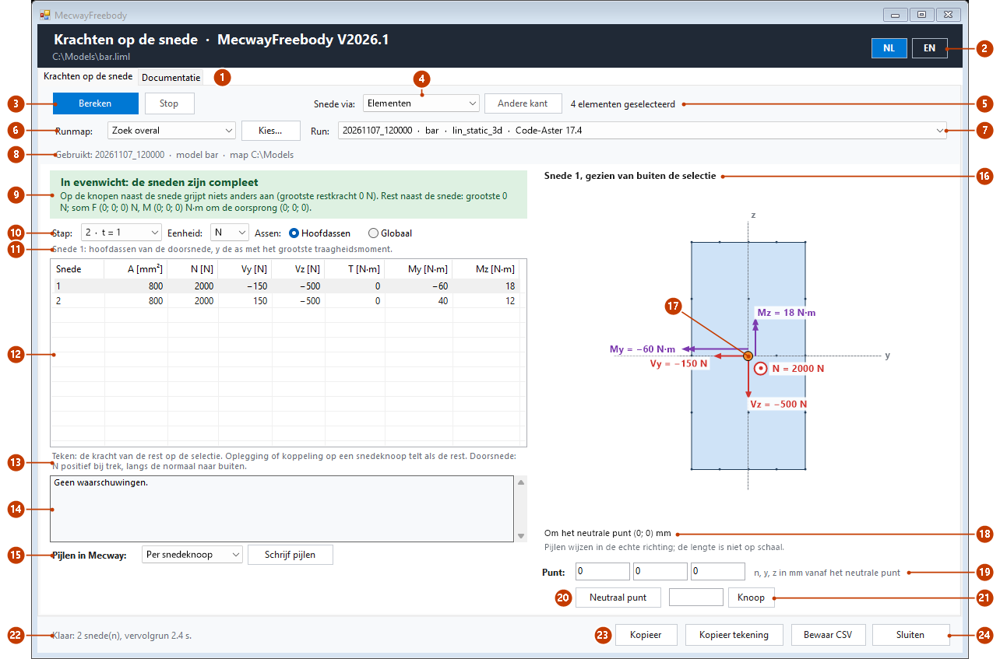
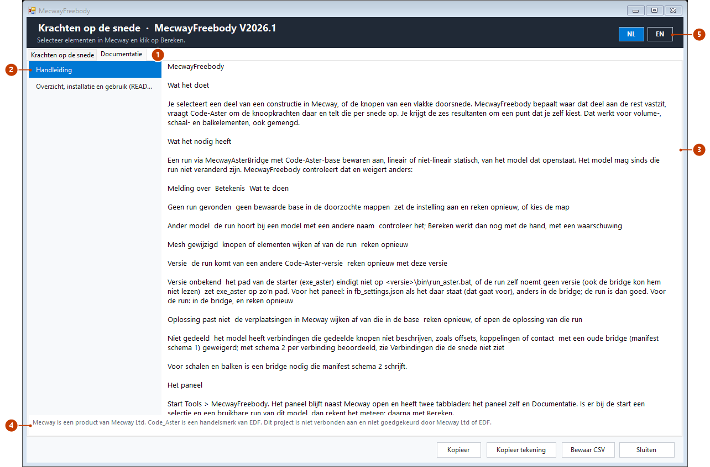
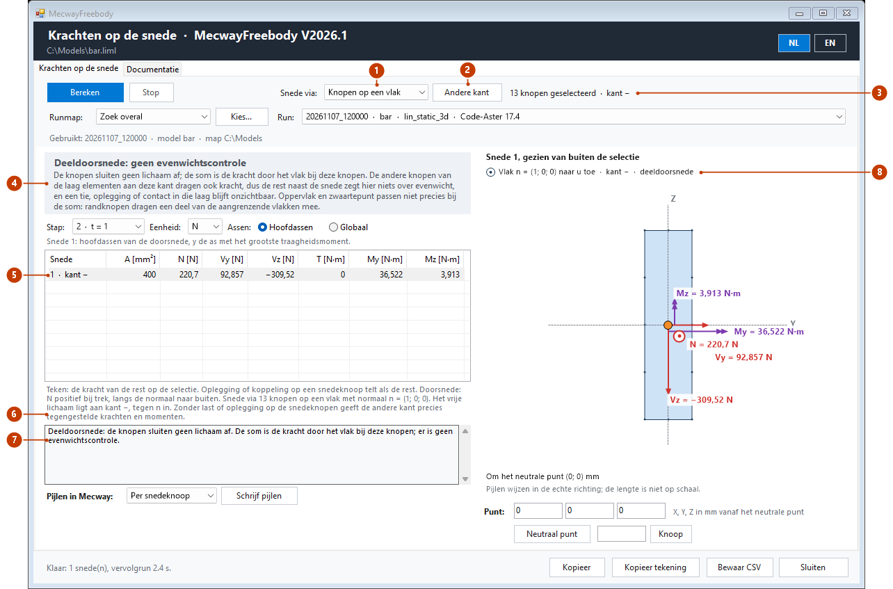
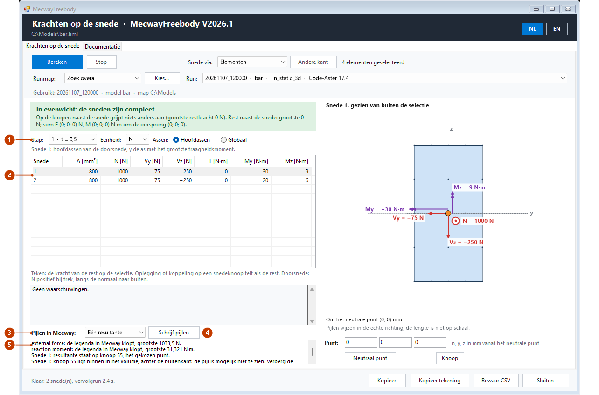

# MecwayFreebody

## Wat het doet

Je selecteert een deel van een constructie in Mecway, of de knopen van een vlakke doorsnede. MecwayFreebody bepaalt waar dat deel aan de rest
vastzit, vraagt Code-Aster om de knoopkrachten daar en telt die per snede op. Je krijgt de zes resultanten om een punt dat je zelf kiest. Dat
werkt voor volume-, schaal- en balkelementen, ook gemengd.

## Wat het nodig heeft

Een run via MecwayAsterBridge V2026.9 of nieuwer met *Code-Aster-base bewaren* aan, lineair of niet-lineair statisch, van het model dat openstaat. Het model mag
sinds die run niet veranderd zijn. MecwayFreebody controleert dat en weigert anders:

| Melding over | Betekenis | Wat te doen |
|---|---|---|
| Geen run gevonden | geen bewaarde base in de doorzochte mappen | zet de instelling aan en reken opnieuw, of kies de map |
| Ander model | de run hoort bij een model met een andere naam | controleer het; Bereken werkt dan nog met de hand, met een waarschuwing |
| Mesh gewijzigd | knopen of elementen wijken af van de run | reken opnieuw |
| Versie | de run komt van een andere Code-Aster-versie | reken opnieuw met deze versie |
| Versie onbekend | het pad van de starter (`exe_aster`) eindigt niet op `<versie>\bin\run_aster.bat`, of de run zelf noemt geen versie (ook de bridge kon hem niet lezen) | zet `exe_aster` op zo'n pad. Voor het paneel: in `fb_settings.json` als het daar staat (dat gaat voor), anders in de bridge; de run is dan goed. Voor de run: in de bridge, en reken opnieuw |
| Oplossing past niet | de verplaatsingen in Mecway wijken af van die in de base | reken opnieuw, of open de oplossing van die run |
| Niet gedeeld | het model heeft verbindingen die gedeelde knopen niet beschrijven, zoals offsets, koppelingen of contact | met een oude bridge (manifest schema 1) geweigerd; met schema 2 per verbinding beoordeeld, zie *Verbindingen die de snede niet ziet* |

Voor schalen en balken is een bridge nodig die manifest schema 2 schrijft.

## Het paneel

Start *Tools* > *MecwayFreebody*. Het paneel blijft naast Mecway open en heeft twee tabbladen: het paneel zelf en *Documentatie*. Is er bij
de start een selectie en een bruikbare run van dit model, dan rekent het meteen; daarna met **Bereken**.

*De afbeeldingen in deze handleiding zijn buiten beeld gemaakt met het echte paneel (`tools/fb_figures.py`), op een eigen voorbeeld: een
balk van 200 × 20 × 40 mm (hex20), ingeklemd bij x = 0, met op het eind een last van (2000; 150; −500) N die in twee stappen oploopt. De
vervolgrun van Code-Aster is nagebootst met de statica van die balk; de snede, de sommen en de teksten zijn die van het paneel. Het pad van het
model en de map van de run (`C:\Models`) zijn voorbeelden. Het is geen meting.*

### Snede via elementen

*Een plak van de balk geselecteerd, van x = 80 tot 120 mm: twee sneden.*

| Nr | Onderdeel | Wat het doet |
|---|---|---|
| 1 | Tabbladen | *Krachten op de snede* is het paneel; *Documentatie* toont deze handleiding en de README (zie *Documentatie in het paneel*). |
| 2 | NL / EN | Kiest de taal van alle teksten en van de handleiding. De keuze blijft bewaard. Kop en voettekst staan op beide tabbladen. |
| 3 | Bereken, Stop | **Bereken** leest selectie en mesh, zoekt de run, maakt de snede en start de korte vervolgrun op de achtergrond; naast **Stop** loopt dan een balk. **Stop** breekt dat af. |
| 4 | Snede via | *Elementen*: de snede volgt uit de geselecteerde elementen. *Knopen op een vlak*: zie *Snede via knopen op een vlak*. *Andere kant* werkt alleen bij knopen. |
| 5 | Selectie | Wat er in Mecway geselecteerd is. Het paneel kijkt dat elke seconde na; een tabel van een andere selectie wordt grijs, met een regel die dat zegt. |
| 6 | Runmap, Kies... | Waar het paneel de runs van de bridge zoekt: overal, naast het model, in de werkmap van de bridge, of in een map die je kiest. |
| 7 | Run | De gevonden runs van deze mesh, de nieuwste eerst: run, model, analyse en Code-Aster-versie. |
| 8 | Runregel | Welke run gebruikt wordt en uit welke map, of in rood waarom hij niet bruikbaar is (zie *Wat het nodig heeft*). |
| 9 | Evenwicht | Groen: in evenwicht, de sneden zijn compleet. Rood: er grijpt nog iets anders aan, met de plek. Grijs bij stap 0 en bij een deeldoorsnede. Zie *Evenwicht* onder *Het resultaat lezen*. |
| 10 | Stap, Eenheid, Assen | De stap van de vervolgrun (standaard de laatste), N of kN, en de eigen assen van de snede of globaal. Tabel en tekening volgen direct. |
| 11 | Assenregel | Welke assen de geselecteerde snede heeft. |
| 12 | Tabel | Per snede het oppervlak en N, Vy, Vz, T, My en Mz om het gekozen punt. Klik een rij aan om die snede te tekenen. |
| 13 | Teken | Hoe de getallen te lezen zijn: de kracht van de rest op de selectie, N positief bij trek. |
| 14 | Waarschuwingen | Meldingen over de snede en de run; de codes staan onder *Schalen en balken*. |
| 15 | Pijlen in Mecway | Zet de krachten als pijlen in de oplossing van Mecway; zie *Pijlen in Mecway*. |
| 16 | Tekening | De snede gezien van buiten de selectie, met de snedeknopen, de assen door het neutrale punt en de krachten (rood) en momenten (paars) met hun waarde. Wat loodrecht op het beeld staat, zoals N hier, is een stip (naar je toe) of een kruis (het beeld in). |
| 17 | Gekozen punt | Het punt waarom de momenten gelden (oranje). Sleep het met de muis; de getallen volgen zonder nieuwe run. |
| 18 | Om het punt | Waar het punt ligt. De pijlen wijzen in de echte richting; hun lengte is niet op schaal. |
| 19 | Punt | Het punt getypt, in mm vanaf het neutrale punt; de tekst ernaast zegt in welke assen. |
| 20 | Neutraal punt | Zet het punt terug op het neutrale punt: het zwaartepunt, met E gewogen. |
| 21 | Knoop | Zet het punt op een knoop: het getypte nummer, anders de knoop die in Mecway geselecteerd is, anders de dichtstbijzijnde snedeknoop. |
| 22 | Status | Wat het paneel doet of net deed; een fout staat in rood. |
| 23 | Kopieer, Kopieer tekening, Bewaar CSV | De tabel als tekst naar het klembord, de tekening als afbeelding naar het klembord, of de tabel als CSV-bestand. |
| 24 | Sluiten | Sluit het paneel. |

### Documentatie in het paneel

*Deze afbeelding is gemaakt zonder het browserelement en toont daarom de tekstweergave. In het paneel staat de handleiding opgemaakt, met
koppen, tabellen en deze afbeeldingen. Is er geen browserelement, dan toont het paneel de tekstweergave, met de beschrijving van een
afbeelding tussen haken.*

| Nr | Onderdeel | Wat het doet |
|---|---|---|
| 1 | Documentatie | Het tabblad met de handleiding en de README. |
| 2 | Lijst | De handleiding in de taal van het paneel, en de README (Engels). |
| 3 | Document | Het gekozen document. Een link naar een ander document opent hier, een link naar een kop springt daarheen, een webadres opent in de standaardbrowser; andere links openen niet, met een melding in de statusregel. Ctrl+C kopieert geselecteerde tekst. |
| 4 | Merken | De merknotitie. |
| 5 | NL / EN | Wisselt ook de handleiding van taal. |

Of het browserelement in Mecway de afbeeldingen toont, is niet gemeten. Ze staan als data in de pagina; dat werkt alleen als het
browserelement de pagina toont als Internet Explorer 9 of nieuwer, en de pagina vraagt daarom. Zie je ze niet, lees deze handleiding dan
op GitHub of in een andere Markdown-viewer.

## Het resultaat lezen

- **Sneden.** Knopen die de selectie deelt met de rest. Losse groepen zijn losse sneden. Sneden die knopen delen zijn één snede, omdat de kracht
  in een gedeelde knoop niet te splitsen is.
- **Teken.** De kracht van de rest op de selectie. N is positief bij trek, langs de normaal die uit de selectie wijst.
- **Punt.** Standaard het neutrale punt: het zwaartepunt, met E gewogen bij meerdere materialen. Slepen verplaatst alleen het punt; er is geen nieuwe
  run nodig.
- **Assen.** De eigen assen van de snede, of globaal. Bij een volumesnede zijn de eigen assen de hoofdassen van de doorsnede; voor schalen en
  balken zie *Schalen en balken*. Een snede die niet vlak is heeft geen duidelijke normaal: die krijgt globale assen.
- **Stappen.** Standaard de laatste stap. Stap 0 is de begintoestand.
- **Grote verplaatsingen.** Momenten worden op de vervormde vorm opgeteld waar de run met grote verplaatsingen rekende, anders op de onvervormde vorm.
- **Evenwicht.** Kracht die overblijft op knopen van de selectie die niet op een snede liggen. Een oplegging of veer op de selectie zie je hier met
  opzet terug. Een tie of bonded contact is geen gedeelde knoop en dus geen snede: de controle toont de kracht en waar die zit. De controle telt
  ook knoopmomenten mee. Het moment van die rest is om de oorsprong (0; 0; 0), niet om het punt van de tabel. Een knoop telt als belast
  boven een tolerantie van 1e-4 maal de kleinste resultante van de sneden van die stap, zodat een lichte snede niet wegvalt naast een
  zware; de ruis van de solver is de ondergrens (bij niet-lineair 1e-5 van de grootste knoopkracht op de sneden). Een snede met bijna
  geen kracht (bijvoorbeeld één knoop van een contact) maakt de controle daardoor strenger, tot die ondergrens.

Een oplegging, koppeling, contact of veer op een snedeknoop telt als "de rest". Een knoopkracht op een snedeknoop telt aan de kant van de selectie.

## Snede via knopen op een vlak

Kies bij *Snede via* de optie *Knopen op een vlak*, selecteer in Mecway de knopen van een vlakke doorsnede en klik op **Bereken**. MecwayFreebody
maakt van de knopen een elementselectie aan één kant van het vlak; daarna loopt alles als bij een selectie van elementen.

- **Middenknopen.** Die hoef je niet te selecteren. Middenknopen op een ribbe waarvan beide hoekknopen geselecteerd zijn, horen vanzelf bij de
  snede, ook de middenknopen die Code-Aster toevoegt. Andere middenknopen horen er niet bij.
- **Vlak.** Een vlak door de geselecteerde knopen (kleinste kwadraten). Het vlak moet langs elementvlakken lopen: een element aan een
  geselecteerde knoop mag geen knopen aan beide kanten van het vlak hebben.
- **Kant en normaal.** De normaal n van het vlak heeft een vast teken: de grootste component is positief. Kant + is de kant waar n heen wijst,
  kant − de andere. Standaard ligt het vrije lichaam aan kant +; *Andere kant* kiest de andere kant en rekent opnieuw. De normaal waarlangs N
  telt, wijst van de gekozen kant af. Zolang er geen last of oplegging op de snedeknopen zit, geeft de andere kant precies tegengestelde
  resultanten. De kant en n staan in de tabel en in de tekening (een stip: n wijst naar je toe, een kruis: n wijst het beeld in).
- **Volledige doorsnede.** Vanuit de elementen aan de gekozen kant die een geselecteerde knoop raken, groeit de selectie over gedeelde knopen,
  zonder over de geselecteerde knopen heen te gaan. Blijft die groei aan haar kant, dan is het een echte vrijsnede: alles werkt als bij
  elementen, ook de controle op evenwicht.
- **Deeldoorsnede** (`partial_section`). Lekt de groei naar de andere kant, bijvoorbeeld als alleen de bovenste helft van een doorsnede is
  geselecteerd, dan sluiten de knopen geen lichaam af; de som is de kracht door het vlak bij deze knopen. Het vrije lichaam is dan de laag
  elementen aan de gekozen kant die een geselecteerde knoop raakt, en de som loopt alleen over de geselecteerde knopen en hun middenknopen.
  Er is geen evenwichtscontrole, want de andere knopen van die laag dragen ook kracht, en een tie, oplegging of contact in die laag blijft
  onzichtbaar. Oppervlak en zwaartepunt passen niet precies bij de som: randknopen dragen een deel van de aangrenzende vlakken mee.
- **Niet gedeelde knopen** (`selected_not_cut`). Geselecteerde knopen die de rest niet deelt, dragen geen kracht in de som; het paneel noemt ze.
- **Alleen volume-elementen aan de knopen.** Zit er een schaal of balk aan een geselecteerde knoop, dan weigert het paneel. Schalen en
  balken elders in het vrije lichaam mogen: een volledige doorsnede rekent als een selectie van die elementen.

*Hetzelfde voorbeeld: de helft y ≥ 0 van de doorsnede bij x = 80 mm geselecteerd (13 knopen), daarna Andere kant. Het vrije lichaam ligt
aan kant −; de knopen sluiten geen lichaam af, dus het is een deeldoorsnede.*

| Nr | Onderdeel | Wat het doet |
|---|---|---|
| 1 | Snede via | *Knopen op een vlak*. De keuze blijft bewaard. Er wordt niet vanzelf gerekend; een tabel van de andere manier wordt grijs. |
| 2 | Andere kant | Kiest de andere kant van het vlak en rekent meteen opnieuw. Tot die run klaar is, is de tabel van de vorige kant grijs. |
| 3 | Selectie | Het aantal geselecteerde knopen en de gekozen kant, + of −. |
| 4 | Melding | Hier een deeldoorsnede: geen evenwichtscontrole, met de reden. Bij een volledige doorsnede staat hier de evenwichtscontrole, zoals bij elementen. |
| 5 | Rij | De snede en de kant. |
| 6 | Teken | Het aantal knopen, de normaal n van het vlak en de kant van het vrije lichaam; zonder last of oplegging op de snedeknopen geeft de andere kant tegengestelde krachten en momenten. |
| 7 | Waarschuwingen | Hier de deeldoorsnede (`partial_section`); ook niet gedeelde knopen (`selected_not_cut`) staan hier. |
| 8 | Vlak | De normaal van het vlak langs de kijkrichting (een stip: naar je toe, een kruis: het beeld in), de kant, en *deeldoorsnede* als dat zo is. |

**Wat geweigerd wordt.** Het paneel zegt het in woorden; tussen haakjes de code.

| Geval | Code |
|---|---|
| Een geselecteerde knoop hoort niet bij de mesh | `unknown_node` |
| Minder dan drie knopen, of alle knopen op één lijn | `nodes_collinear` |
| Een geselecteerde knoop hoort bij geen volume-element | `nodes_without_solid` |
| De knopen liggen niet in één vlak; MecwayFreebody raadt niet welke knopen bedoeld zijn | `nodes_not_planar` |
| Een schaal of balk aan een geselecteerde knoop | `shell_or_beam` |
| Het vlak loopt door elementen heen | `plane_through_elements` |
| Aan de gekozen kant ligt geen element: kies de andere kant | `side_empty` |
| De rest van het model deelt geen van de knopen | `no_cut` |
| De knopen van de vervolgrun passen niet bij de snede | `node_mismatch` |

Daarna gelden voor het vrije lichaam dezelfde weigeringen als bij een selectie van elementen.

## Pijlen in Mecway

*Pijlen* vult de velden *external force* en *reaction moment* van de open oplossing. Klik de groep aan in de boom van Mecway om ze te zien.

*Hetzelfde voorbeeld als bij Snede via elementen, met stap 1 gekozen en de pijlen geschreven als één resultante per snede, in een
nagemaakte oplossing.*

| Nr | Onderdeel | Wat het doet |
|---|---|---|
| 1 | Stap | Een stap van de vervolgrun, met zijn tijd t. Tabel en tekening volgen direct; de pijlen in Mecway pas na opnieuw *Schrijf pijlen*. |
| 2 | Tabel | De getallen van die stap: hier de helft van de last van stap 2. |
| 3 | Pijlen in Mecway | *Per snedeknoop*: de knoopkrachten zelf, op de snedeknopen. *Eén resultante*: per snede de som, op de snedeknoop die het dichtst bij het gekozen punt ligt. |
| 4 | Schrijf pijlen | Vult de velden in de oplossing van Mecway, in de stap met de tijd van de gekozen stap. |
| 5 | Verslag | Wat er geschreven is: per veld of de legenda in Mecway klopt en de grootste waarde, op welke knoop een resultante staat (en of die binnen het volume ligt, zoals hier) en welke stap. Met een schuifbalk als het niet past. |

- Pijlen staan op knopen. Een resultante komt op de dichtstbijzijnde snedeknoop; het paneel noemt die.
- Een resultante op een knoop binnen het volume kan achter het oppervlak verborgen zijn; het paneel zegt dat dan. Zet het punt met *Knoop*
  op een snedeknoop aan de buitenkant (de momenten gelden dan om die knoop), verberg in Mecway de elementen aan één kant van de snede,
  of kies pijlen per snedeknoop.
- Ze hebben een vaste schaal, omdat Mecway de legenda van de eerste keer houdt. Het paneel geeft de schaal.
- Een bestaand veld wordt nooit overschreven.
- Sla je het model op, dan komen de velden in het `.liml`.

## Schalen en balken

Een selectie mag schaal- en balkelementen bevatten, ook gemengd met volume-elementen. Ondersteund zijn de schaalmodellen DKT, DST en
COQUE_3D en de lijnmodellen POU_D_E, POU_D_T, BARRE en CABLE.

**Wat een snede is, per soort element.** De krachten blijven knoopkrachten. Snedeknopen zijn de knopen die de selectie deelt met de rest.

| Soort | Snede | Een buur buiten de selectie telt als |
|---|---|---|
| Volume | vlak | een volume-element |
| Schaal | ribbe | een **schaal**element over dezelfde ribbe |
| Balk | eindknoop | een element buiten de selectie dat de knoop ook heeft |

Delen sneden knopen, dan zijn ze één snede. Een balk die eindigt op een schaalribbe of volumevlak maakt de snede gemengd. Bij kwadratische
schalen horen de middenknopen op de ribbe bij de snede. Bij balken met drie knopen kijkt MecwayFreebody naar de helft die bij de snede ligt.
Bij staven (BARRE, CABLE) is er alleen N; de andere getallen staan als –.

**Assen per geval.**

| Geval | Assen |
|---|---|
| Volume, of een vlakke verzameling schaalribben (I, C, koker) | hoofdassen van de doorsnede |
| Eén schaalstrook, of stroken op één rechte lijn in één vlak (een plaat recht doorgesneden) | n, t, w (zie Tekens) |
| Eén balk | de balkassen die Code-Aster gebruikte |
| Eén staaf | de staafas, alleen N |
| Gemengd, niet vlak, of meer balken op één snedeknoop | globaal |
| Schaal of balk die met grote verplaatsingen rekende | globaal, met de waarschuwing `large_axes` |

Waarom: bij een vlakke doorsnede zijn hoofdassen het meest bruikbaar. Een plaat die recht is doorgesneden houdt n, t, w, zodat de assen niet
omklappen als je één element meer selecteert. Eén balk heeft eigen assen die Code-Aster zelf gebruikte; bij een L-profiel zijn dat de
hoofdassen, niet de richtingen van de benen, en het paneel zegt dat. Bij een gemengde of niet-vlakke snede is er geen gemeenschappelijk vlak.
Bij grote verplaatsingen draaien de lokale assen mee met de vorm, dus zijn de onvervormde assen fout.

De sectie van een balk komt uit wat Code-Aster kreeg, de dikte van een schaal uit Mecway. Schalen tellen dunwandig mee in de doorsnede, als
strook t x L op de middenlijn, bij een excentriciteit (EXCENTREMENT) verschoven langs de schaalnormaal.

**Tekens.**

- Balk: N is positief bij trek, langs de uitwaartse normaal van de selectie. Ligt de snede bij knoop 2 van het element, dan is dat de lokale +x.
  Bij knoop 1 is het -x; dan zijn x en z gespiegeld en blijft y gelijk.
- Schaalstrook: n ligt in het vlak van de schaal, loodrecht op de ribbe, uit het geselecteerde element. t loopt langs de ribbe. w is de
  schaalnormaal, met een vast teken (grootste component positief), en t = w x n. Je krijgt N (langs n, positief bij trek), V_t, V_w, T (om
  n), M_t (om t) en M_w (om w). M_w is altijd als onbetrouwbaar gemarkeerd, met (?).

**Boorstijfheid (`drilling`).** Code-Aster geeft schalen een fictieve stijfheid om de schaalnormaal (`COEF_RIGI_DRZ`). Het moment dat daarin
verdwijnt, staat niet in de knoopkrachten van de snede. Dat speelt ook als de oorzaak voorbij de snede ligt. Het paneel waarschuwt als:

- de schalen van het model niet in één vlak liggen (een knik of kromming, waar ook in het model);
- een element dat geen schaal is, een knoop heeft van een schaal in de selectie of van een schaal buiten de selectie aan de snede;
- een verbinding uit *Niet gedeeld* (koppeling, contact, tie) zo'n schaalknoop raakt.

Een knoopmoment om de schaalnormaal geeft dezelfde fout, ook op een vlakke plaat, en ook voorbij de snede; het paneel waarschuwt daarvoor.
Een moment in het vlak van de schaal is geen probleem. Mecway geeft de lasten niet via zijn scripttaal, dus leest het paneel de momenten uit
het opgeslagen `.liml`-bestand, zoals de bridge: een moment op één knoop of één balkeinde telt, en uit voorzorg ook een voorgeschreven
rotatie die niet nul is (niet gemeten). Een moment op vlakken maakt de bridge tot krachten; dat telt niet. Is de richting niet te bepalen (een formule, een onbekende eenheid,
een draaiend tijdsverloop), dan telt het moment als "om de normaal". Onderdrukte lasten tellen ook mee. Sla het model op na het wijzigen
van lasten. Kan het paneel het bestand of een selectie niet lezen, dan zegt het dat (`moments_unread`) en meldt het zo'n moment niet.

Gemeten in de ketentests met Code-Aster (`tests/test_aster_shells_e2e.py`): een knoopmoment om de normaal tot enkele procenten (2,7e-2), een
knik veel minder (3,6e-5). De melding noemt de waarde van `COEF_RIGI_DRZ`; zonder waarde is dat de standaard van Code-Aster (1e-5).
Een volume-element aan een schaal gaf geen fout boven de ruis; de waarschuwing blijft daar uit voorzorg.

**Waarschuwingen.** Het paneel toont de meeste meldingen in woorden. `beam_axes_missing`, `relation_on_cut` en `not_shared` hebben geen
eigen tekst en verschijnen als code.

| Melding | Betekenis |
|---|---|
| `drilling` | zie *Boorstijfheid* |
| `moments_unread` | het paneel: de momentlasten waren niet te lezen (model niet opgeslagen, geen `.liml`, of een onbekende selectie); een knoopmoment om de schaalnormaal wordt dan niet gemeld |
| `large_axes` | een strook of balk rekende met grote verplaatsingen: globale assen |
| `skin_shell` | een geselecteerde schaal ligt op een volumevlak buiten de selectie, of een schaal buiten de selectie op een geselecteerd volumevlak. Dat is een grensvlak, geen snede; ribben met een schaalbuur blijven wel een snede |
| `beam_along_cut` | beide knopen van een balk liggen op de snede. De balk telt mee in de kracht |
| `node_contact` | een snedeknoop ligt op geen enkele snede-entiteit van zijn soort, bijvoorbeeld een schaalribbe op een volumevlak of een plaatrand naast een balk. De kracht zit in de som, maar niet in het neutrale punt, de assen of de tekening. Bij alleen volume-elementen heet dit `edge_contact` |
| `mixed_cut` | een snede mengt volumes, schalen of balken: globale assen, om het met E gewogen zwaartepunt van alle delen |
| `mixed_shape` | het paneel: in deze snede zijn delen op x en delen op x + u opgeteld (kleine en grote verplaatsingen door elkaar) |
| `thickness_missing` | een strook heeft geen dikte: de stroken van de snede wegen dan alleen naar hun lengte, en er is geen oppervlak |
| `section_missing` | een balk heeft geen sectie: de balken van de snede wegen dan even zwaar, en er is geen oppervlak |
| `no_thickness` | het paneel: Mecway gaf voor deze componenten geen schaaldikte |
| `beam_axes_missing` | de run gaf geen balkassen: x langs het element, y en z gekozen |
| `relation_on_cut` | een verbinding die geheel in de selectie ligt, raakt een snedeknoop. Haar kracht zit in de som van de snede |
| `not_shared` | een verbinding uit *Niet gedeeld* raakt de snede niet. Werkt ze op knopen van de selectie, dan toont de controle op evenwicht haar kracht |

Bij volumesneden kunnen ook `edge_contact`, `edge_merge`, `midside_not_shared`, `skin_on_cut`, `E_missing`, `no_normal` en `non_planar`
verschijnen, elk met een eigen tekst in het paneel.

**Verbindingen die de snede niet ziet.** Met manifest schema 2 noemt de bridge per verbinding (offset, koppeling, contact) de knopen, en
MecwayFreebody legt die naast de selectie (per soort verbinding, als de bridge de verbindingen niet apart noemt):

- raakt ze een snedeknoop en heeft ze ook knopen buiten de selectie: geweigerd (`not_shared_on_cut`);
- raakt ze een snedeknoop en ligt ze geheel in de selectie: de waarschuwing `relation_on_cut`;
- raakt ze geen snedeknoop: de waarschuwing `not_shared`;
- een offset met knopen in de selectie: geweigerd (`offset`).

**Wat geweigerd wordt.**

| Geval | Code | Waarom |
|---|---|---|
| POU_D_TG (welving) | `beam_warping` | de knoopkrachten van dit balktype kloppen niet in Code-Aster. Let op: met de bridge-instelling `elem_beam` = POU_D_TG wordt daardoor elke balk geweigerd |
| Balken met grote rotaties: POU_D_T_GD, of een balk die met GROT_GDEP rekende | `beam_large_rotation` | de assen draaien mee; dat wordt nog niet ondersteund |
| Een offset met verschoven knopen in de selectie (`offset_links`) | `offset` | de snede loopt dan via knopen die de selectie niet deelt |
| Schalen of balken met een run van een oude bridge (manifest schema 1) | `schema_old` | de bridge schrijft niet wat nodig is; werk de bridge bij naar V2026.9 of nieuwer |
| Een verbinding uit *Niet gedeeld* aan een snedeknoop met ook knopen buiten de selectie | `not_shared_on_cut` | de kracht op de snede is dan niet eenduidig |
| Een onbekende elementvorm, of een schaal of lijnelement met een ander model, zoals een veer (DIS_T) of Q4G | `shape` | niet gemeten |
| Een geselecteerde schaal of balk waarvan een niet-lineaire run niet zegt of hij met grote verplaatsingen rekende | `deformation` | de vorm om op te sommeren is onbekend |
| Een run met verbindingen uit *Niet gedeeld* zonder leesbare knopen, of met een oude bridge (schema 1) | `not_shared` | de snede is niet te beoordelen |
| Een component die het manifest niet kent | `schema` | werk de bridge en MecwayFreebody bij |

## Grenzen

- Volume-, schaal- en balkelementen werken, ook gemengd, lineair en niet-lineair statisch.
- Niet in de keten met Code-Aster getest: niet-lineaire schalen en balken, tie en RBE3 bij schalen en balken, orthotrope schalen en kabels.
- Snede via knopen op een vlak: de geselecteerde knopen moeten bij volume-elementen horen, zonder schaal of balk eraan.
- Bij schalen is het moment om de normaal onbetrouwbaar; zie *Boorstijfheid*. Knoopmomenten leest het paneel uit het opgeslagen `.liml`.
- Resultaten van Mecway's eigen solver en van CalculiX worden niet ondersteund.
- Modale, knik- en harmonische resultaten, HOMARD en XFEM worden geweigerd.

## Merken

Mecway is een product van Mecway Ltd. Code_Aster is een handelsmerk van EDF. Dit project is niet verbonden aan en niet goedgekeurd door Mecway Ltd of EDF.
