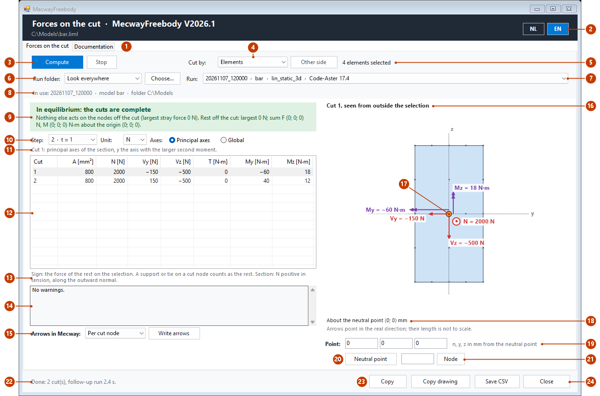
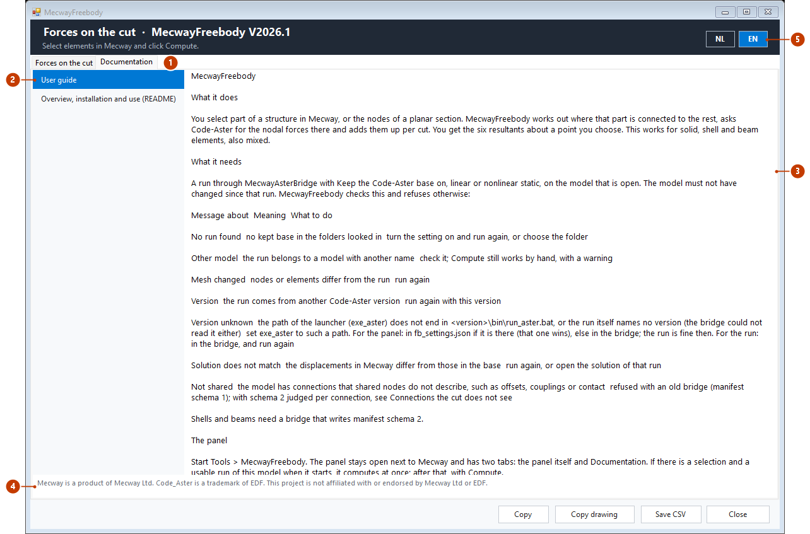
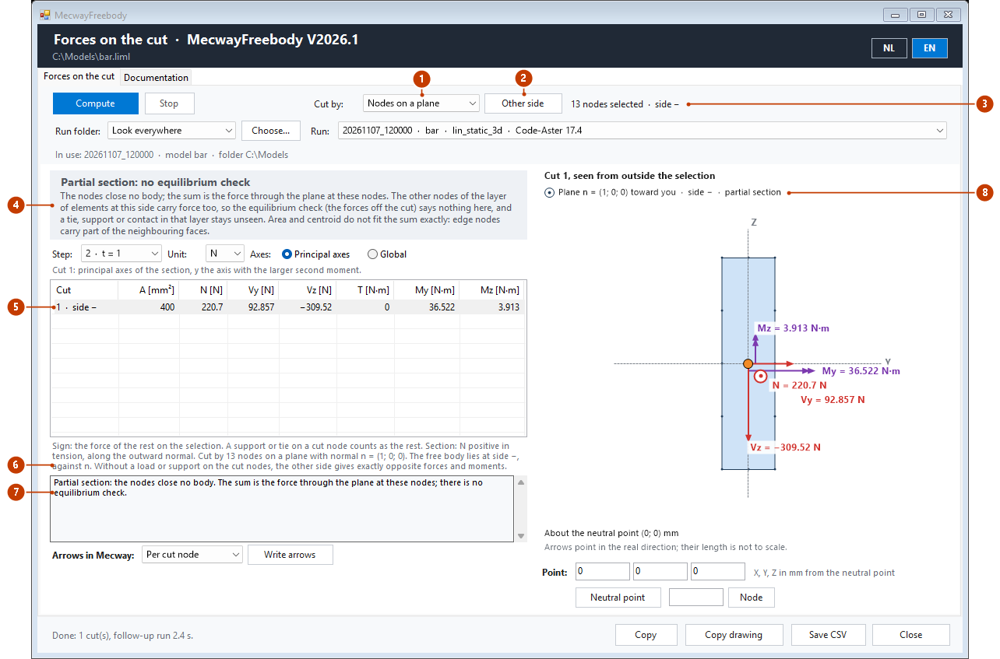
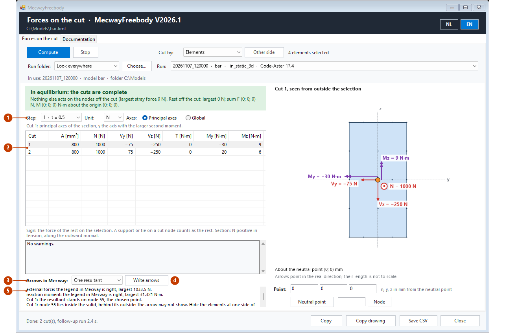

# MecwayFreebody

## What it does

You select part of a structure in Mecway, or the nodes of a planar section. MecwayFreebody works out where that part is connected to the
rest, asks Code-Aster for the nodal forces there and adds them up per cut. You get the six resultants about a point you choose. This works
for solid, shell and beam elements, also mixed.

## What it needs

A run through MecwayAsterBridge V2026.9 or newer with *Keep the Code-Aster base* on, linear or nonlinear static, on the model that is open. The model must
not have changed since that run. MecwayFreebody checks this and refuses otherwise:

| Message about | Meaning | What to do |
|---|---|---|
| No run found | no kept base in the folders looked in | turn the setting on and run again, or choose the folder |
| Other model | the run belongs to a model with another name | check it; Compute still works by hand, with a warning |
| Mesh changed | nodes or elements differ from the run | run again |
| Version | the run comes from another Code-Aster version | run again with this version |
| Version unknown | the path of the launcher (`exe_aster`) does not end in `<version>\bin\run_aster.bat`, or the run itself names no version (the bridge could not read it either) | set `exe_aster` to such a path. For the panel: in `fb_settings.json` if it is there (that one wins), else in the bridge; the run is fine then. For the run: in the bridge, and run again |
| Solution does not match | the displacements in Mecway differ from those in the base | run again, or open the solution of that run |
| Not shared | the model has connections that shared nodes do not describe, such as offsets, couplings or contact | refused with an old bridge (manifest schema 1); with schema 2 judged per connection, see *Connections the cut does not see* |

Shells and beams need a bridge that writes manifest schema 2.

## The panel

Start *Tools* > *MecwayFreebody*. The panel stays open next to Mecway and has two tabs: the panel itself and *Documentation*. If there is a
selection and a usable run of this model when it starts, it computes at once; after that, with **Compute**.

*The images in this guide were made off-screen with the real panel (`tools/fb_figures.py`), on an example of its own: a bar of 200 × 20 ×
40 mm (hex20), clamped at x = 0, with a load of (2000; 150; −500) N on its end that rises in two steps. The follow-up run of Code-Aster is
stood in for by the statics of that bar; the cut, the sums and the texts are the panel's. The path of the model and the folder of the run (`C:\Models`) are examples. It is not a
measurement.*

### Cut by elements

*A slice of the bar selected, from x = 80 to 120 mm: two cuts.*

| No. | Part | What it does |
|---|---|---|
| 1 | Tabs | *Forces on the cut* is the panel; *Documentation* shows this guide and the README (see *Documentation in the panel*). |
| 2 | NL / EN | Chooses the language of all texts and of the guide. The choice is kept. Header and footer are on both tabs. |
| 3 | Compute, Stop | **Compute** reads selection and mesh, looks for the run, makes the cut and starts the short follow-up run in the background; a bar runs next to **Stop** meanwhile. **Stop** ends it. |
| 4 | Cut by | *Elements*: the cut follows from the selected elements. *Nodes on a plane*: see *Cut by nodes on a plane*. *Other side* only works with nodes. |
| 5 | Selection | What is selected in Mecway. The panel looks every second; a table of another selection turns grey, with a line that says so. |
| 6 | Run folder, Choose... | Where the panel looks for the runs of the bridge: everywhere, next to the model, in the work folder of the bridge, or in a folder you choose. |
| 7 | Run | The runs found for this mesh, newest first: run, model, analysis and Code-Aster version. |
| 8 | Run line | Which run is used and from which folder, or in red why it cannot be used (see *What it needs*). |
| 9 | Equilibrium | Green: in equilibrium, the cuts are complete. Red: something else acts as well, with the place. Grey at step 0 and for a partial section. See *Equilibrium* under *Reading the result*. |
| 10 | Step, Unit, Axes | The step of the follow-up run (the last by default), N or kN, and the cut's own axes or global ones. Table and drawing follow at once. |
| 11 | Axes line | Which axes the selected cut has. |
| 12 | Table | Per cut the area and N, Vy, Vz, T, My and Mz about the chosen point. Click a row to draw that cut. |
| 13 | Sign | How to read the numbers: the force of the rest on the selection, N positive in tension. |
| 14 | Warnings | Messages about the cut and the run; the codes are under *Shells and beams*. |
| 15 | Arrows in Mecway | Puts the forces as arrows in Mecway's solution; see *Arrows in Mecway*. |
| 16 | Drawing | The cut seen from outside the selection, with the cut nodes, the axes through the neutral point and the forces (red) and moments (purple) with their values. What stands perpendicular to the picture, as N here, is a dot (toward you) or a cross (into the picture). |
| 17 | Chosen point | The point the moments are about (orange). Drag it with the mouse; the numbers follow without a new run. |
| 18 | About the point | Where the point lies. The arrows point in the real direction; their length is not to scale. |
| 19 | Point | The point typed, in mm from the neutral point; the text next to it says in which axes. |
| 20 | Neutral point | Puts the point back on the neutral point: the centroid, weighted by E. |
| 21 | Node | Puts the point on a node: the typed number, else the node selected in Mecway, else the nearest cut node. |
| 22 | Status | What the panel does or just did; an error shows in red. |
| 23 | Copy, Copy drawing, Save CSV | The table as text on the clipboard, the drawing as an image on the clipboard, or the table as a CSV file. |
| 24 | Close | Closes the panel. |

### Documentation in the panel

*This image was made without the browser element, so it shows the text view. In the panel the guide is formatted, with headings, tables
and these images. Without a browser element the panel shows the text view, with the description of an image in brackets.*

| No. | Part | What it does |
|---|---|---|
| 1 | Documentation | The tab with the guide and the README. |
| 2 | List | The guide in the language of the panel, and the README (English). |
| 3 | Document | The chosen document. A link to another document opens here, a link to a heading jumps there, a web address opens in the default browser; other links do not open, with a message in the status line. Ctrl+C copies selected text. |
| 4 | Trademarks | The trademark notice. |
| 5 | NL / EN | Switches the guide to the other language as well. |

Whether the browser element in Mecway shows the images has not been measured. They are in the page as data; that only works when the
browser element shows the page as Internet Explorer 9 or newer, and the page asks for that. If you do not see them, read this guide on
GitHub or in another Markdown viewer.

## Reading the result

- **Cuts.** Nodes the selection shares with the rest. Separate groups are separate cuts. Cuts that share nodes are one cut, because a force in
  a shared node cannot be divided.
- **Sign.** The force of the rest on the selection. N is positive in tension, along the normal pointing out of the selection.
- **Point.** By default the neutral point: the centroid, E weighted with several materials. Dragging only moves the point; no new run is needed.
- **Axes.** The cut's own axes, or global. For a solid cut the own axes are the principal axes of the section; for shells and beams see
  *Shells and beams*. A cut that is not flat has no clear normal: it gets global axes.
- **Steps.** By default the last step. Step 0 is the starting state.
- **Large displacements.** Moments are summed on the deformed shape where the run computed with large displacements, otherwise on the
  undeformed shape.
- **Equilibrium.** Force left on nodes of the selection that are not on a cut. A support or spring on the selection shows up here on purpose.
  A tie or bonded contact is not a shared node, so it is no cut: the check shows the force and where it is. The check counts nodal moments
  too. The moment of that rest is about the origin (0; 0; 0), not about the point of the table. A node counts as loaded above a
  tolerance of 1e-4 times the smallest resultant of the cuts of that step, so a light cut does not hide behind a heavy one; the noise of
  the solver is the lower limit (nonlinear: 1e-5 of the largest nodal force on the cuts). A cut with almost no force (for example a single
  node of a contact) therefore makes the check stricter, down to that limit.

A support, coupling, contact or spring on a cut node counts as "the rest". A nodal force on a cut node counts on the side of the selection.

## Cut by nodes on a plane

Choose *Nodes on a plane* under *Cut by*, select the nodes of a planar section in Mecway and click **Compute**. MecwayFreebody turns the
nodes into an element selection at one side of the plane; from there everything runs as with a selection of elements.

- **Midside nodes.** You need not select them. Midside nodes on an edge whose two corner nodes are selected belong to the cut by themselves,
  also the midside nodes Code-Aster adds. Other midside nodes do not belong to it.
- **Plane.** A plane through the selected nodes (least squares). The plane must follow element faces: an element on a selected node may not
  have nodes at both sides of the plane.
- **Side and normal.** The normal n of the plane has a fixed sign: its largest component is positive. Side + is the side n points to, side −
  the other one. By default the free body lies at side +; *Other side* takes the other side and computes again. The normal along which N
  counts points away from the chosen side. As long as there is no load or support on the cut nodes, the other side gives exactly opposite
  resultants. The side and n are in the table and in the drawing (a dot: n points toward you, a cross: n points into the picture).
- **Full section.** Starting from the elements at the chosen side that touch a selected node, the selection grows over shared nodes, without
  crossing the selected nodes. If that growth stays at its side, it is a true free-body cut: everything works as with elements, including
  the equilibrium check.
- **Partial section** (`partial_section`). If the growth leaks to the other side, for example when only the upper half of a section is
  selected, the nodes close no body; the sum is the force through the plane at these nodes. The free body is then the layer of elements at
  the chosen side that touch a selected node, and the sum runs over the selected nodes and their midside nodes only. There is no equilibrium
  check, because the other nodes of that layer carry force too, and a tie, support or contact in that layer stays unseen. Area and centroid
  do not fit the sum exactly: edge nodes carry part of the neighbouring faces.
- **Nodes not shared** (`selected_not_cut`). Selected nodes the rest does not share carry no force in the sum; the panel names them.
- **Solid elements only at the nodes.** If a shell or beam sits on a selected node, the panel refuses. Shells and beams elsewhere in the
  free body are fine: a full section computes as a selection of those elements.

*The same example: the half y ≥ 0 of the section at x = 80 mm selected (13 nodes), then Other side. The free body lies at side −; the
nodes close no body, so it is a partial section.*

| No. | Part | What it does |
|---|---|---|
| 1 | Cut by | *Nodes on a plane*. The choice is kept. Nothing is computed by itself; a table of the other way turns grey. |
| 2 | Other side | Takes the other side of the plane and computes again at once. Until that run is done, the table of the previous side is grey. |
| 3 | Selection | The number of selected nodes and the chosen side, + or −. |
| 4 | Message | Here a partial section: no equilibrium check, with the reason. For a full section the equilibrium check shows here, as with elements. |
| 5 | Row | The cut and the side. |
| 6 | Sign | The number of nodes, the normal n of the plane and the side of the free body; without a load or support on the cut nodes the other side gives opposite forces and moments. |
| 7 | Warnings | Here the partial section (`partial_section`); nodes that are not shared (`selected_not_cut`) show here too. |
| 8 | Plane | The normal of the plane along the line of sight (a dot: toward you, a cross: into the picture), the side, and *partial section* when it is one. |

**What is refused.** The panel says it in words; the code in brackets.

| Case | Code |
|---|---|
| A selected node is not in the mesh | `unknown_node` |
| Fewer than three nodes, or all nodes on one line | `nodes_collinear` |
| A selected node belongs to no solid element | `nodes_without_solid` |
| The nodes do not lie in one plane; MecwayFreebody does not guess which nodes you meant | `nodes_not_planar` |
| A shell or beam on a selected node | `shell_or_beam` |
| The plane runs through elements | `plane_through_elements` |
| No element lies at the chosen side: choose the other side | `side_empty` |
| The rest of the model shares none of the nodes | `no_cut` |
| The nodes of the follow-up run do not fit the cut | `node_mismatch` |

After that, the free body is subject to the same refusals as a selection of elements.

## Arrows in Mecway

*Arrows* fills the fields *external force* and *reaction moment* of the open solution. Click the group in Mecway's outline tree to see them.

*The same example as under Cut by elements, with step 1 chosen and the arrows written as one resultant per cut, in a stand-in solution.*

| No. | Part | What it does |
|---|---|---|
| 1 | Step | A step of the follow-up run, with its time t. Table and drawing follow at once; the arrows in Mecway only after *Write arrows* again. |
| 2 | Table | The numbers of that step: here half the load of step 2. |
| 3 | Arrows in Mecway | *Per cut node*: the nodal forces themselves, on the cut nodes. *One resultant*: per cut the sum, on the cut node nearest to the chosen point. |
| 4 | Write arrows | Fills the fields in Mecway's solution, in the step with the time of the chosen step. |
| 5 | Report | What was written: per field whether Mecway's legend is right and the largest value, on which node a resultant stands (and whether that node lies inside the solid, as here) and which step. With a scroll bar when it does not fit. |

- Arrows sit on nodes. A resultant goes on the nearest cut node; the panel names it.
- A resultant on a node inside the solid can be hidden behind the surface; the panel says so then. Put the point on a cut node on the outside
  with *Node* (the moments are then about that node), hide the elements at one side of the cut in Mecway, or choose arrows per cut node.
- They have a fixed scale, because Mecway keeps the legend of the first write. The panel gives the scale.
- An existing field is never overwritten.
- If you save the model, the fields go into the `.liml`.

## Shells and beams

A selection may contain shell and beam elements, also mixed with solid elements. Supported are the shell models DKT, DST and COQUE_3D and the
line models POU_D_E, POU_D_T, BARRE and CABLE.

**What a cut is, per element kind.** Forces stay nodal forces. Cut nodes are the nodes the selection shares with the rest.

| Kind | Cut | A neighbour outside the selection counts as |
|---|---|---|
| Solid | face | a solid element |
| Shell | edge | a **shell** element over the same edge |
| Beam | end node | an element outside the selection that also has the node |

Cuts that share nodes are one cut. A beam that ends on a shell edge or a solid face makes the cut mixed. On quadratic shells the midside
nodes on the edge belong to the cut. For beams with three nodes, MecwayFreebody uses the half at the cut. Trusses (BARRE, CABLE) have only N;
the other numbers show as –.

**Axes per case.**

| Case | Axes |
|---|---|
| Solid, or a flat set of shell edges (I, C, box) | principal axes of the section |
| One shell strip, or strips on one straight line in one plane (a plate cut straight across) | n, t, w (see Signs) |
| One beam | the beam axes Code-Aster used |
| One truss | the truss axis, N only |
| Mixed, not flat, or several beams on one cut node | global |
| Shell or beam that computed with large displacements | global, with the warning `large_axes` |

Why: on a flat section, principal axes are the most useful. A plate cut straight across keeps n, t, w, so the axes do not swap when you select
one more element. A single beam has its own axes, which Code-Aster used itself; for an L section these are the principal axes, not the
directions of the legs, and the panel says so. A mixed or non-flat cut has no common plane. With large displacements the local axes turn
with the shape, so the undeformed axes would be wrong.

The section of a beam comes from what Code-Aster got, the thickness of a shell from Mecway. Shells count as thin-walled in the section, as a
strip t x L on the midline, shifted along the shell normal by an offset (EXCENTREMENT).

**Signs.**

- Beam: N is positive in tension, along the outward normal of the selection. If the cut is at node 2 of the element, that is local +x. At
  node 1 it is -x; then x and z are mirrored and y stays.
- Shell strip: n lies in the plane of the shell, perpendicular to the edge, out of the selected element. t runs along the edge. w is the shell
  normal, with a fixed sign (largest component positive), and t = w x n. You get N (along n, positive in tension), V_t, V_w, T (about n), M_t
  (about t) and M_w (about w). M_w is always marked unreliable, with (?).

**Drilling stiffness (`drilling`).** Code-Aster gives shells a fictitious stiffness about the shell normal (`COEF_RIGI_DRZ`). The moment lost
in it is not in the nodal forces of the cut. That also happens when the cause lies beyond the cut. The panel warns when:

- the shells of the model do not lie in one plane (a fold or a curve, anywhere in the model);
- an element that is not a shell has a node of a shell in the selection, or of a shell outside the selection at the cut;
- a connection from *Not shared* (coupling, contact, tie) touches such a shell node.

A nodal moment about the shell normal causes the same error, also on a flat plate and also beyond the cut; the panel warns about it. A
moment in the plane of the shell is no problem. Mecway does not give its loads to scripts, so the panel reads the moments from the saved
`.liml` file, as the bridge does: a moment on one node or one beam end counts, and as a precaution a prescribed rotation that is
not zero (not measured). The
bridge turns a moment on faces into forces; that does not count. If the direction cannot be told (a formula, an unknown unit, a time
history that turns), the moment counts as "about the normal". Suppressed loads count too. Save the model after changing loads. If the
panel cannot read the file or a selection, it says so (`moments_unread`) and does not report such a moment.

Measured in the chain tests with Code-Aster (`tests/test_aster_shells_e2e.py`): a nodal moment about the normal up to a few percent (2.7e-2),
a fold much less (3.6e-5). The message names the value of `COEF_RIGI_DRZ`; without a value it is Code-Aster's default (1e-5).
A solid element attached to a shell gave no error above the noise; the warning stays there as a precaution.

**Warnings.** The panel shows most messages in words. `beam_axes_missing`, `relation_on_cut` and `not_shared` have no text of their own
and appear as a code.

| Message | Meaning |
|---|---|
| `drilling` | see *Drilling stiffness* |
| `moments_unread` | the panel: the moment loads could not be read (model not saved, no `.liml`, or an unknown selection); a nodal moment about the shell normal is then not reported |
| `large_axes` | a strip or beam computed with large displacements: global axes |
| `skin_shell` | a selected shell lies on a solid face outside the selection, or a shell outside the selection on a selected solid face. That is a boundary, not a cut; edges with a shell neighbour still are a cut |
| `beam_along_cut` | both nodes of a beam lie on the cut. The beam counts in the force |
| `node_contact` | a cut node is on no cut entity of its kind, for example a shell edge on a solid face or a plate edge next to a beam. Its force is in the sum, but not in the neutral point, the axes or the drawing. With solid elements only this is `edge_contact` |
| `mixed_cut` | a cut mixes solids, shells or beams: global axes, about the E-weighted centroid of all parts |
| `mixed_shape` | the panel: in this cut some parts are summed on x and some on x + u (small and large displacements together) |
| `thickness_missing` | a strip has no thickness: the strips of the cut then weigh by their length only, and there is no area |
| `section_missing` | a beam has no section: the beams of the cut then weigh alike, and there is no area |
| `no_thickness` | the panel: Mecway gave no shell thickness for these components |
| `beam_axes_missing` | the run gave no beam axes: x along the element, y and z chosen |
| `relation_on_cut` | a connection that lies wholly inside the selection touches a cut node. Its force is in the sum of the cut |
| `not_shared` | a connection from *Not shared* does not touch the cut. If it acts on nodes of the selection, the equilibrium check shows its force |

Solid cuts can also show `edge_contact`, `edge_merge`, `midside_not_shared`, `skin_on_cut`, `E_missing`, `no_normal` and `non_planar`,
each with a text of its own in the panel.

**Connections the cut does not see.** With manifest schema 2 the bridge names the nodes per connection (offset, coupling, contact), and
MecwayFreebody holds them against the selection (per kind of connection, when the bridge does not name the connections separately):

- it touches a cut node and also has nodes outside the selection: refused (`not_shared_on_cut`);
- it touches a cut node and lies wholly inside the selection: the warning `relation_on_cut`;
- it touches no cut node: the warning `not_shared`;
- an offset with nodes in the selection: refused (`offset`).

**What is refused.**

| Case | Code | Why |
|---|---|---|
| POU_D_TG (warping) | `beam_warping` | the nodal forces of this beam type are not right in Code-Aster. Note: with the bridge setting `elem_beam` = POU_D_TG every beam is refused for this reason |
| Beams with large rotations: POU_D_T_GD, or a beam that computed with GROT_GDEP | `beam_large_rotation` | the axes turn along; that is not supported yet |
| An offset with shifted nodes in the selection (`offset_links`) | `offset` | the cut then runs through nodes the selection does not share |
| Shells or beams with a run of an old bridge (manifest schema 1) | `schema_old` | the bridge does not write what is needed; update the bridge to V2026.9 or newer |
| A connection from *Not shared* on a cut node that also has nodes outside the selection | `not_shared_on_cut` | the force on the cut is then not unique |
| An unknown element shape, or a shell or line element with another model, such as a spring (DIS_T) or Q4G | `shape` | not measured |
| A selected shell or beam for which a nonlinear run does not say whether it used large displacements | `deformation` | the shape to sum on is unknown |
| A run with connections from *Not shared* without readable nodes, or from an old bridge (schema 1) | `not_shared` | the cut cannot be judged |
| A component the manifest does not know | `schema` | update the bridge and MecwayFreebody |

## Limits

- Solid, shell and beam elements work, also mixed, linear and nonlinear static.
- Not tested in the chain with Code-Aster: nonlinear shells and beams, tie and RBE3 with shells and beams, orthotropic shells and cables.
- Cut by nodes on a plane: the selected nodes must belong to solid elements, with no shell or beam on them.
- On shells the moment about the normal is unreliable; see *Drilling stiffness*. The panel reads nodal moments from the saved `.liml`.
- Results of Mecway's own solver and of CalculiX are not supported.
- Modal, buckling and harmonic results, HOMARD and XFEM are refused.

## Trademarks

Mecway is a product of Mecway Ltd. Code_Aster is a trademark of EDF. This project is not affiliated with or endorsed by Mecway Ltd or EDF.
